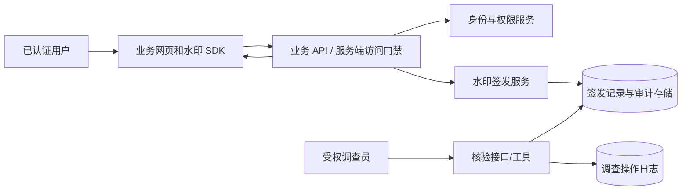
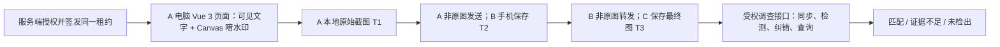

# 架构、信任边界与接口草案

版本：0.3（暗水印部分待用户审阅）。本文定义 Vue 3 + Node.js 首版设计。接口字段是契约草案，首个实现前需经接口评审并在 `DECISIONS.md` 记录最终版本。

## 1. 核心原则

1. **源头是服务端访问事实**：谁在何时访问了哪份受保护内容，由服务端认证、鉴权和审计确定。浏览器上看到的文字是该事实的一个投影。
2. **可见码是调查索引**：追溯码是服务端用安全随机数生成的单次访问标识，不编码姓名、工号、邮箱或租户信息。持久化阶段以唯一约束防止重复签发。展示的文案由企业策略决定。
3. **客户端不可信**：用户可修改页面 DOM/CSS、拦截请求、改图。客户端篡改事件只能作为辅助信号，不能证明没有发生篡改。
4. **每条内容路径独立保护**：网页显示、浏览器打印、服务端 PDF/图片/报表下载、直接 API 获取分别做权限与水印设计。

## 2. 组件与数据流

前端采用 Vue 3 + TypeScript + Vite：业务页面调用 Vue 适配层，适配层管理组件生命周期并调用框架无关的水印核心。首版后端采用 Node.js + TypeScript。共享接口契约是两者之间的唯一数据耦合点；未来其他语言的服务端必须保持同一协议语义并通过契约测试。



受保护内容返回前，业务 API 必须完成认证、资源级授权和水印策略判断。高敏感内容在签发失败时不返回。理想路径是同一次服务端处理原子地生成内容访问记录与水印租约；现有系统如需拆分请求，必须在服务端绑定用户、会话、资源和租约，不能仅依赖前端先后调用顺序。

## 3. 签发记录

每条租约至少包含：`leaseId`、`code`、`tenantId`、`subjectId`、`resourceType`、`resourceId`、`accessEventId`、`issuedAt`、`expiresAt`、`policyVersion`、`status`。其中 `code` 为服务端生成的 96 位以上随机值，经人可读的 Base32 编码并分组显示；签发时执行唯一性检查，冲突重试。身份、资源映射仅受授权服务可读；正式持久化后须验证数据库访问控制。

`expiresAt` 控制该租约能否继续用于当前页面；过期记录仍可按经批准的保留期用于历史调查。页面时间使用服务端签发时间，客户端时钟不作为审计依据。服务端密钥、访问凭证和原始会话 ID 不进入响应或普通日志。

## 3.1 分阶段存储边界（待审）

- 当前 S1 演示使用 Node.js 进程内 `Map` 和数组；重启即丢失，只能用于虚构身份和短时本地验证。
- T0/T1 编解码与原图实验可继续使用进程内映射和固定测试清单。预期码来自独立生成的真值清单；私有逐图结果、样本与本地运行数据放受控目录，不提交 Git。这一阶段不能宣称跨重启历史核验或生产审计。
- 首次需要跨重启、跨天复查签发事实，或进入真实 A→B→C 采集前，必须引入持久化租约、明暗码映射、访问事件和调查审计。单机、单服务实例的虚构数据研究环境建议先用本地 SQLite 文件及唯一约束/事务；文件放 `artifacts/` 等忽略目录，数据库文件不入 Git。SQLite 是嵌入式数据库，不要求另起数据库服务；真实身份数据进入前需另行确定磁盘保护、访问权限和备份策略。
- 多服务实例、跨主机共享写入或生产接入时，需选可集中访问且具备备份恢复能力的事务型存储，并验证租户隔离、保留期、审计完整性与故障恢复。具体引擎由部署拓扑和企业运维要求定案；数据访问接口与 HTTP 契约不依赖 SQLite。

## 4. 接口契约草案

### 4.1 受保护内容与签发

优先形态：`GET /api/protected/{resourceType}/{resourceId}/view` 在同一授权链路返回内容及 `watermark` 对象。已有系统也可通过 `POST /api/watermark/v1/leases` 签发，但业务内容 API 必须独立完成权限检查和必要的租约门禁。

```json
{
  "watermark": {
    "code": "ABCD-EFGH-JKLM-NPQR-STUV",
    "issuedAt": "2026-11-02T02:00:00Z",
    "expiresAt": "2026-11-02T02:05:00Z",
    "displayText": "内部资料 · 员工别名 · 2026-11-02 10:00",
    "policyVersion": "v1",
    "layout": { "density": "standard", "opacity": 0.12 }
  },
  "content": { "...": "由业务接口定义" }
}
```

示例码仅用于格式说明，实际长度、字母表和校验格式在接口评审时固定。`displayText` 需要长度限制和安全文本渲染。SDK 不拼接未转义 HTML。

响应状态：`401` 未认证，`403` 无资源权限，`409` 当前访问状态冲突，`429` 限流，`503` 签发服务不可用。返回机器可读的错误码和关联请求 ID，不泄露他人身份与资源信息。

### 4.2 续期与撤销

短时租约由服务端依据现有会话与当前资源重新授权后续期。退出登录、权限撤销、资源切换应触发前端清除；服务端撤销状态独立生效。前端定时器只能安排刷新，不是权限裁决者。

### 4.3 核验

`POST /api/watermark/v1/verify`，请求含 `code` 与调查案件编号；服务端验证调查员角色、案件权限与租户边界后，返回匹配记录的最小必要字段、状态、相关访问事件 ID、证据提示和核验请求 ID。无匹配与无权限必须分清内部审计，但外部响应避免枚举信息。每次核验及导出报告均记调查操作日志并限流。

## 5. 前端 SDK 设计

核心公开方法建议：`mount(root, lease, options)`、`update(lease)`、`destroy()`；Vue 3 适配层提供组件/组合式函数并在组件卸载时自动销毁。输入由接入层从可信业务响应取得，SDK 仅验证结构与到期时间，不宣称能验证用户身份。重复挂载应保持幂等。

前端不得直接读取 Node.js 数据库结构、进程变量或内部审计对象。服务端以版本化 HTTP/JSON 对外，时间字段统一 UTC ISO 8601，错误使用稳定机器码。契约及其测试独立于服务端语言，语言迁移时复用同一组输入、输出与错误场景。

可见水印层使用 SVG/DOM 文本平铺与受控样式，不依赖远程图片或无界定时重绘。固定在指定受保护容器或视口，覆盖主内容和弹窗；元素设置 `pointer-events: none`、`aria-hidden="true"`，不加入 Tab 序列。尺寸变化时节流更新。对于原生全屏和跨源 iframe，接入业务方需单独处理；SDK 不跨越浏览器同源边界。

打印路径使用专门的打印布局验证。浏览器打印可能应用不同样式；不能仅用 CSS 背景图来保证水印落入打印/PDF。打印/PDF 失败时，该业务路径切换到服务端受控生成方案。水印失效的浏览器告警只作诊断，不作阻断判据。

## 5.1 明暗双通道与两次转发（目标设计）

可见文字层沿用服务端签发的高熵追溯码；暗水印候选设计为独立 64 位随机标识，经纠错和带同步信息的图块扩散到视口。两者只通过服务端租约映射关联，不从标识本身编码姓名或工号。服务端密钥不出服务端；浏览器只获得当前访问所需图块。客户端可移除、复制或伪造图块，因此图片匹配只是调查线索。



T1、T2、T3 的文件和操作记录不可互相替代。若 T1 原图识别不稳定，先定位签发、图块、合成、截图或解码环节，不通过社交平台实验掩盖基础问题。具体算法、接口与指标分别见 WATERMARK_RESEARCH_PLAN.md、API_CONTRACT.md、BENCHMARK_PROTOCOL.md；这些都是候选设计，非已通过能力。
## 5.2 目标业务系统与 SDK 接入边界

用户提供的宽屏管理后台截图用于确定首批页面结构，水印最终须在运行中的 Vue 3 系统中绘制，而不是事后处理截图。目前无法取得业务系统源码，因此本仓库先交付框架无关核心、Vue 3 适配层和虚构数据验证页；实际系统接入与 R-16 验收保持未完成。接入位置、路由、Teleport 弹窗、全屏、跨源 iframe 和服务端内容门禁需拿到源码或正式接入点后逐项核对。具体范围见 TARGET_SYSTEM_INTEGRATION.md。

## 6. 威胁与控制

| 威胁 | 控制措施 | 剩余风险 |
| --- | --- | --- |
| 删除或覆盖叠层 | 渲染健康检查、接入回归、服务端访问记录 | 用户可完全控制浏览器；无法保证强制显示 |
| 替换他人码或伪造截图 | 码对应唯一签发记录，核对样本时间、资源、访问日志 | 截图可以被人工合成；码只能提供线索 |
| 枚举追溯码 | 高熵随机码、受权核验、限流、审计 | 已外泄码仍可能被复制 |
| 直接调用内容 API | 服务端资源授权和高敏感内容签发门禁 | 未纳入的旧 API 仍需盘点整改 |
| 访问日志被改写 | 限权、追加写入或等效完整性控制、异地备份、调查留痕 | 有特权的内部攻击仍需独立审计 |
| 隐私泄露 | 短文案、服务端映射、保留期限、角色隔离 | 截图仍可能显示可见身份文案 |
| 二次非原图转发 | 同步、冗余与纠错候选；C 最终文件的真实链路验收 | 重压缩、缩放或裁剪可彻底抹除暗水印；不保证任意图可恢复 |
| 复制或伪造暗水印 | 与服务端访问记录、资源、时间和样本来源交叉核对 | 命中暗码只说明图案对应某次签发，不自动证明发送者 |

## 7. 证据等级

- L0：截图无法可靠读取追溯码；无法归属。
- L1：可读码匹配签发记录；仅说明该码曾签发给某次访问。
- L2：L1 加上可信原始样本、相符资源和时间、访问日志及合理一致的上下文；可作为重点调查对象。
- L3：L2 加独立证据和经授权的复核流程；最终责任判断由企业调查制度决定，系统不自动定责。

报告应同时显示有利和不利证据，以及裁剪、重压缩、样本来源不明等限制。

## 8. 安全与隐私依据

参照 [OWASP ASVS 安全事件要求](https://cornucopia.owasp.org/taxonomy/asvs-5.0/16-security-logging-and-error-handling/03-security-events) 对敏感访问留痕；参照 [OWASP 日志指南](https://cheatsheetseries.owasp.org/cheatsheets/Logging_Cheat_Sheet) 对日志最小化、完整性和访问控制进行设计；打印行为按 [MDN 打印文档](https://developer.mozilla.org/en-US/docs/Web/CSS/Guides/Media_queries/Printing) 逐浏览器验证。
